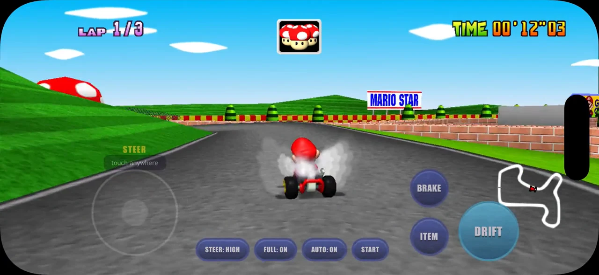
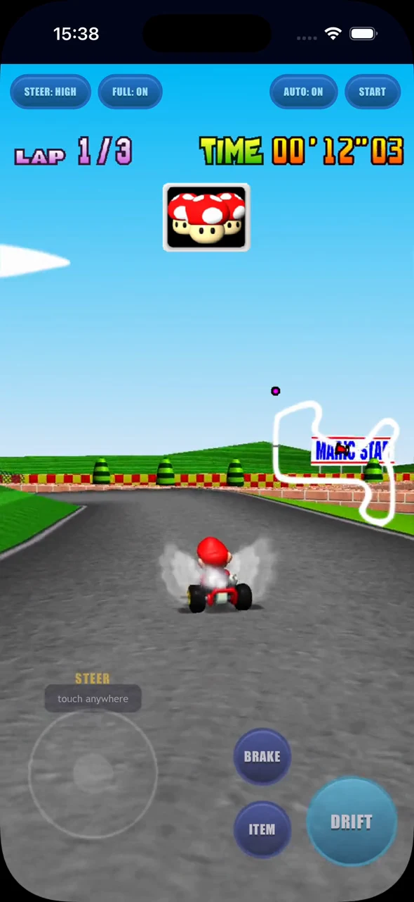
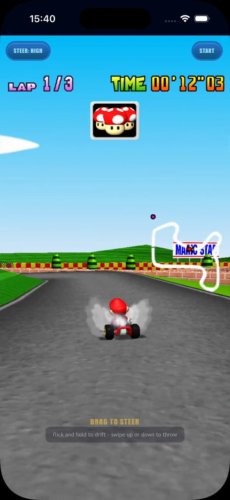

# Kart64

Kart64 brings Mario Kart 64 to a browser tab: familiar circuits, item battles,
and the satisfaction of carrying a drift through the next corner. Race a
Grand Prix at your desk or chase a faster Time Trial on your phone, with
keyboard, gamepad, and touch controls.

> **Unofficial project.** Kart64 is not affiliated with or endorsed by Nintendo.

The game is compiled to WebAssembly from the MK64 decompilation through
[SpaghettiKart](https://github.com/HarbourMasters/SpaghettiKart), with a browser
frontend that handles the ROM, saves, screen layout, and phone controls.

**Play: https://eddmann.com/kart64/**

Bring your own legally dumped US ROM, press **Start**, and let the browser
prepare the game. It checks the ROM and extracts its assets locally; nothing
is uploaded, and the ROM is removed from browser storage after extraction.
The first run takes about a minute. After that, the cached game boots straight
away, ready for your next race. Single-player Grand Prix and Time Trials are
supported. On an iPhone, add the page to your Home Screen to keep the extracted
game data available between visits.

## Controls

| | Desktop | Phone |
|---|---|---|
| Steer | arrow keys or WASD | touch anywhere on the left |
| Accelerate (A) | X or Shift | automatic (AUTO) |
| Brake (B) | C or Ctrl | BRAKE |
| Item (Z) | Z | ITEM |
| Hop / drift (R) | Space or R | DRIFT |
| Start / pause | Enter | START |
| Full screen | F | FULL button |

Choose **CTRL: TOUR** for a one-thumb portrait scheme: drag to steer, flick
and hold to drift, and swipe to throw items. Full screen fills the display
while racing; menus and results keep their 4:3 layout.

The [playing guide](docs/playing.md) covers phone menus, Tour gestures,
and full-screen options. Optional
[texture packs](docs/texture-packs.md) give the tracks and characters a sharper
finish, with lighter cuts suited to phones.

## Phone showcase

Mario Raceway's grass banks, brick walls, and giant pipe set the scene for
three ways to race on a phone. Landscape gives you a wide view of the circuit;
portrait keeps the steering pad and action buttons within reach; Tour fills
the portrait display with a view built around one-thumb gestures.

Below, each mode reaches the same first-lap bend, captured in the iOS Home
Screen PWA with **MK64 Reloaded phone karts128**. Follow a complete run from
the countdown through all three Time Trial laps to the results. These silent
showcase recordings use the game's test autopilot.

| Landscape full screen | Portrait with buttons | Portrait Tour |
|---|---|---|
|  |  |  |
| [Complete video · 2:28](media/mario-raceway/sources/landscape.mp4) | [Complete video · 2:21](media/mario-raceway/sources/portrait.mp4) | [Complete video · 2:30](media/mario-raceway/sources/tour.mp4) |

**Watch a complete landscape run**, with a wide view of the circuit and the
action buttons beside the minimap:

https://github.com/user-attachments/assets/af517acd-9206-4ee4-a220-3ba7752af3ed

[See the modes side by side through a second-lap drift, with all three complete videos](media/mario-raceway/README.md).

## Documentation

| Guide | What you’ll find |
|---|---|
| [Playing Kart64](docs/playing.md) | Phone setup, Tour controls, and screen modes |
| [Texture packs](docs/texture-packs.md) | Loading packs and making lighter versions for phones |
| [Development](docs/development.md) | Repository layout, local builds, and engine patches |
| [Testing](docs/testing.md) | Startup, layout, ROM, and race checks |
| [Deployment](docs/deployment.md) | GitHub Pages, static hosting, and cross-origin isolation |

ROM files and extracted game assets are never committed or deployed. Each
player provides their own ROM and extracts it in their own browser.

## Credits

Built on [SpaghettiKart](https://github.com/HarbourMasters/SpaghettiKart) by
HarbourMasters, the Mario Kart 64 decompilation it is based on, and
[libultraship](https://github.com/Kenix3/libultraship) by Kenix3, compiled with
[Emscripten](https://emscripten.org/). The phone showcase uses a trimmed copy of
[MK64 Reloaded](https://github.com/GhostlyDark/MK64-Reloaded) by GhostlyDark.

## Licence

Kart64's own code is available under the [MIT licence](LICENSE). The files in
`patches/` modify SpaghettiKart and libultraship and remain subject to those
projects’ terms. No ROM or Nintendo game assets are included.

Mario Kart 64 is a trademark of Nintendo. Kart64 is not affiliated with or
endorsed by Nintendo.
