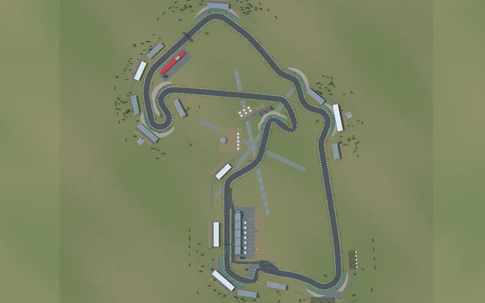
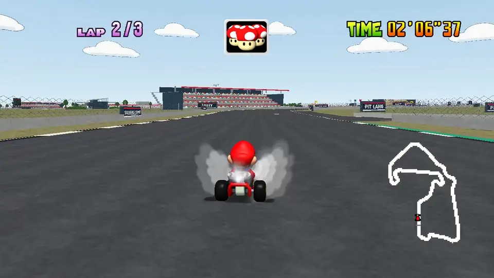
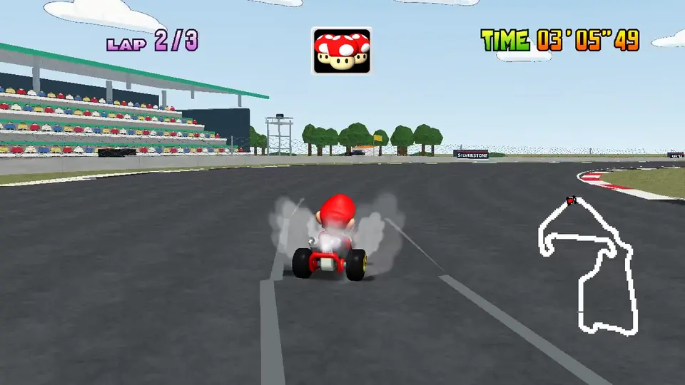
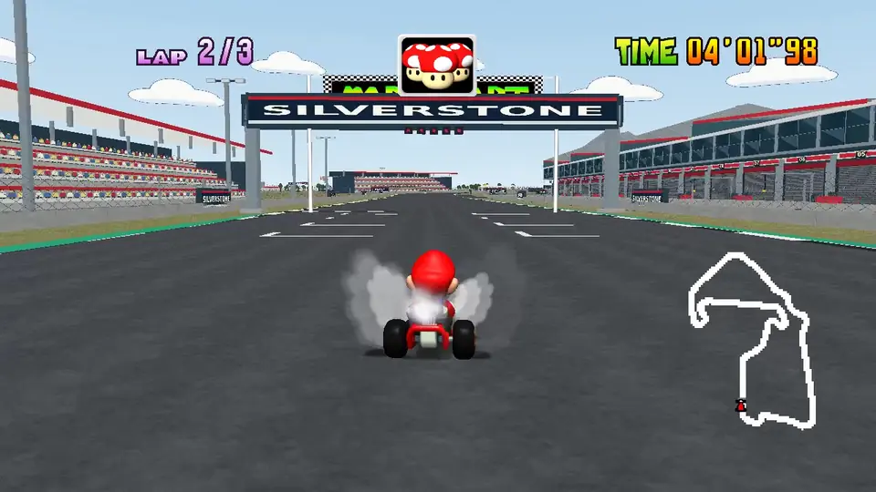

# Silverstone gallery

[Back to Silverstone](../README.md)

The deployed site serves this gallery at `courses/silverstone/media/`, with the
videos playable in the page. The game never loads it.

## One lap as Mario

[A complete GP lap](silverstone-mario-full-lap.mp4) recorded in native
SpaghettiKart with AI-assisted driving and game audio: 2 minutes 7 seconds,
960×540 at 24 fps, 16.2 MB. It plays at the speed it was recorded. The stock
characters and HUD use the MK64 Reloaded texture pack, which is not part of the
course.

## Verstappen versus Mario

[A side-by-side comparison](silverstone-verstappen-vs-mario.mp4) with Max
Verstappen's 2025 British GP pole lap: 88 seconds, 1920×720 at 30 fps, 29.2 MB.
The left side is the
[official Formula 1 onboard](https://www.formula1.com/en/video/onboard-max-verstappens-2025-pirelli-pole-position-award-lap-at-the-british-grand-prix.1836826066949110291)
at its recorded speed, with its original audio and watermark. On the right, the
Mario lap is retimed between 23 landmarks so the two stay aligned through all 18
turns; each speed change is labelled on screen.

The alignment is approximate: road widths, scenery and cameras differ, and the
comparison follows the GP route without the pit shortcut.
[comparison-sync.json](comparison-sync.json) has the checkpoint timings.

## Screenshots

22 native frames cover the grid, every corner, both long straights and the
finish, and two Blender renders show the whole layout: 24 WebP images, 0.79 MB
in total. [manifest.json](manifest.json) lists their titles, sizes and hashes.

