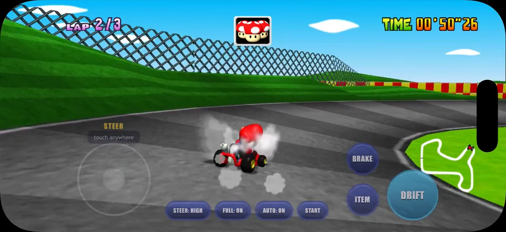
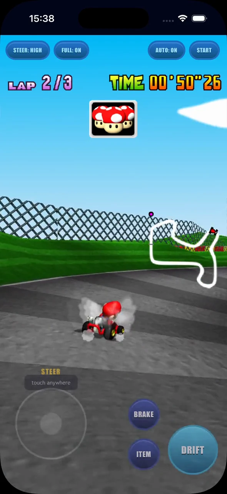
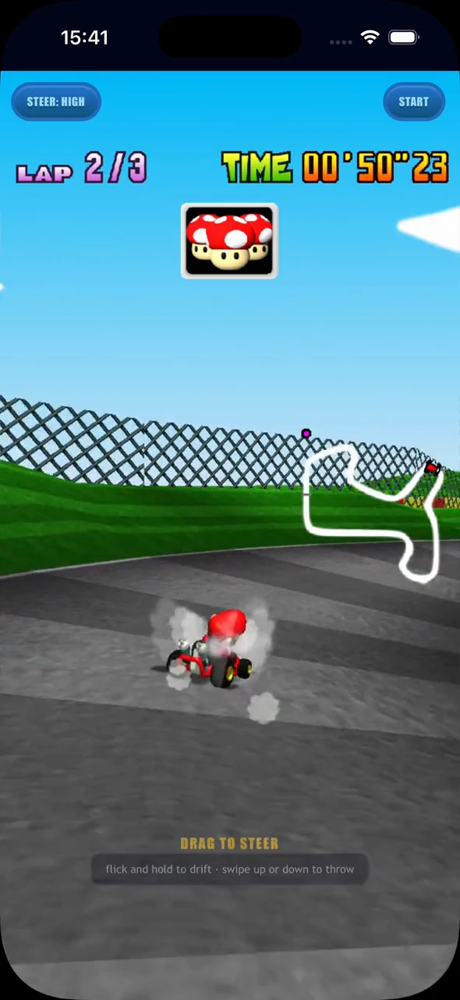

# Mario Raceway on a phone

Green hills, red-and-yellow barriers, and a giant pipe over the road: Mario
Raceway makes a familiar setting for a closer look at Kart64 on a phone.
Follow the same route in **landscape full screen**, **portrait with buttons**,
and **portrait Tour**, with matching screenshots that show how each mode
frames the circuit and places its controls.

All three use the **MK64 Reloaded phone karts128** texture pack, captured in
the iOS 26 Simulator's Home Screen PWA.

## Complete gameplay videos

From the opening countdown to the final lap, each video follows a complete
three-lap Time Trial and finishes on the results screen. Landscape opens up
the view across the track. Portrait brings the steering pad and action buttons
into the lower part of the display, while Tour clears those buttons for its
gesture controls.

The compact MP4s play at recorded speed. They are silent and use the game's
test autopilot, so you can compare the layouts and textures along the same
racing line.

| Mode | Complete video | Size | Resolution |
|---|---|---:|---|
| Landscape full screen | [2:28 · MP4](sources/landscape.mp4) | 34.8 MB | 1280×590 |
| Portrait with buttons | [2:21 · MP4](sources/portrait.mp4) | 25.2 MB | 590×1280 |
| Portrait Tour | [2:30 · MP4](sources/tour.mp4) | 25.6 MB | 590×1280 |

### Landscape full screen

The wide view follows Mario around the circuit, with the action buttons
beside the minimap.

https://github.com/user-attachments/assets/af517acd-9206-4ee4-a220-3ba7752af3ed

### Portrait with buttons

The taller view keeps the steering pad and action buttons near the bottom,
leaving the road ahead in view.

https://github.com/user-attachments/assets/ee12d39c-52b9-4077-8117-a01aa873975f

### Portrait Tour

Tour opens up the portrait display for its one-thumb gesture controls.

https://github.com/user-attachments/assets/e42cd664-a782-4033-bf2d-2db7ed56f6e8

## First bend

Approaching the first sweeping bend, the grass bank rises on the left and the
Mario Star billboard sits ahead. All three views catch this moment at
approximately **12 seconds** on the race clock, making the difference between
the wide landscape view and the taller portrait views easy to see.
Click any screenshot to see it at full size.

| Landscape full screen | Portrait with buttons | Portrait Tour |
|---|---|---|
| [](screenshots/first-bend-landscape.webp) | [](screenshots/first-bend-portrait.webp) | [](screenshots/first-bend-tour.webp) |

## Second-lap drift

On the second lap, Mario leans into a right-hand corner with tyre smoke
trailing the kart. At approximately **50 seconds** on the race clock, compare
the landscape buttons beside the minimap, the portrait controls near the
bottom of the display, and Tour's view without the action deck.

| Landscape full screen | Portrait with buttons | Portrait Tour |
|---|---|---|
| [](screenshots/second-lap-landscape.webp) | [](screenshots/second-lap-portrait.webp) | [](screenshots/second-lap-tour.webp) |

<details>
<summary>Capture and regeneration notes</summary>

Captured on **7 October 2026**. The screenshots preserve the complete display,
including the portrait status bar and simulator mask. Matching frames were
checked against the visible race clock; modes align within 0.1 seconds.

The three complete sources use H.264 at 24 fps and total approximately 83 MiB.
The inline players use GitHub-hosted attachments of these same MP4s; the
table above links to the committed sources for download.
Full-resolution MP4s and raw simulator recordings remain in the local
`kart64-recordings/2026-10-07/mario-raceway-karts128` backup. The texture pack
is a separate user-provided file.

Steering is automated. The local recording fixture reused extracted test
assets and enabled the existing test autopilot. The recordings demonstrate
the presentation of each mode rather than manual control input.

[manifest.json](manifest.json) records source offsets, screenshot times,
dimensions, durations, sizes and SHA-256 hashes. [capture.json](capture.json)
records the original recording and texture-pack hashes and source compression.

To regenerate the six screenshots and their manifest, install `ffmpeg`,
`ffprobe` and `cwebp`, then run from the repository root:

```sh
make media/screenshots
```

The script reads the three complete sources. No Python dependencies are needed.

</details>
